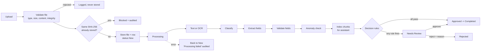
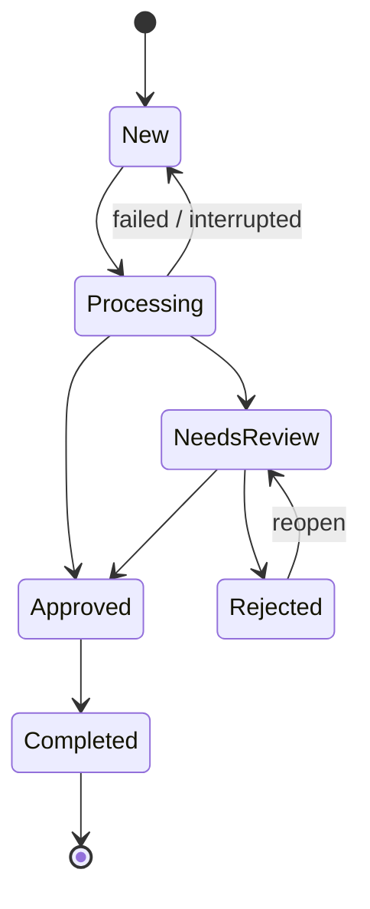

# Architecture

## Layers

| Layer | Files | Rule |
|---|---|---|
| Interfaces | `app.py` (Streamlit), `api.py` (FastAPI) | Only show data and call `service` / `workflow` / `rag` / `database`. No business rules here. |
| Orchestration | `service.py` | Runs the stages in order, times each one, handles errors, never raises out of a batch. |
| Rules | `workflow.py`, `validator.py`, `anomaly.py` | Decide what is acceptable. Rules are plain functions in lists, so they are easy to change. |
| Processing | `storage.py`, `processor.py`, `classifier.py`, `extractor.py` | Turn bytes into text, a type and fields. |
| Assistant | `rag.py` | Chunk, index, retrieve, answer from quoted lines. |
| Persistence | `database.py`, `audit.py` | SQLite (WAL mode). All paths from `config.py`. |

## Pipeline (what `service.run_workflow` does)

## State machine

`workflow.change_status` is the only place a status changes. It checks the move, writes the audit row, and refuses anything else.

## Data model (SQLite)

| Table | Holds |
|---|---|
| `documents` | One row per stored file: hash, type, confidence (or NULL), text, fields, validation, anomalies, per-stage timings (JSON), status, review reason, times |
| `audit_log` | Append-only history: document, action, previous status, new status, UTC time, note |
| `chunks` | Text chunks of each processed document, used by the assistant |
| `qa_log` | Every assistant question: answered or not, best score, term coverage, source ids |
| `upload_rejections` | Files refused at upload, with the reason |

Older Week 5 databases are upgraded automatically (missing columns are added).

## Design decisions

* **No invented numbers.** The keyword classifier gives no probability, so no confidence is stored. A confidence appears only when a trained model supplies one. "Required fields found" is a real count, shown separately.
* **Local assistant.** TF-IDF retrieval keeps documents on the server and makes every answer traceable to a line of text.
* **Reuse before recompute.** Hash check at upload, "already processed" check before the pipeline, OCR cache, index cache.
* **Fail small.** A failure puts one document back to New with a plain reason; the batch continues. After a crash, documents stuck in Processing are returned to New at start-up.
* **Reading settings at call time** (`config.NAME`) so tests and deployments can change them without code changes.
