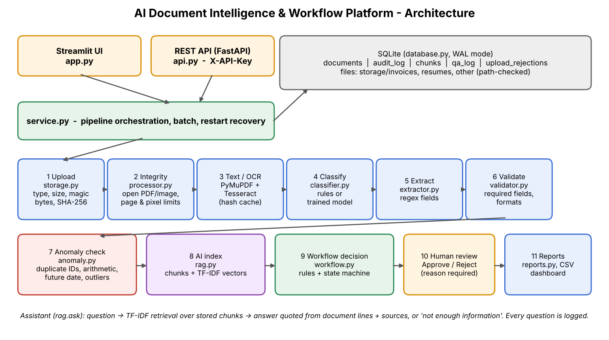
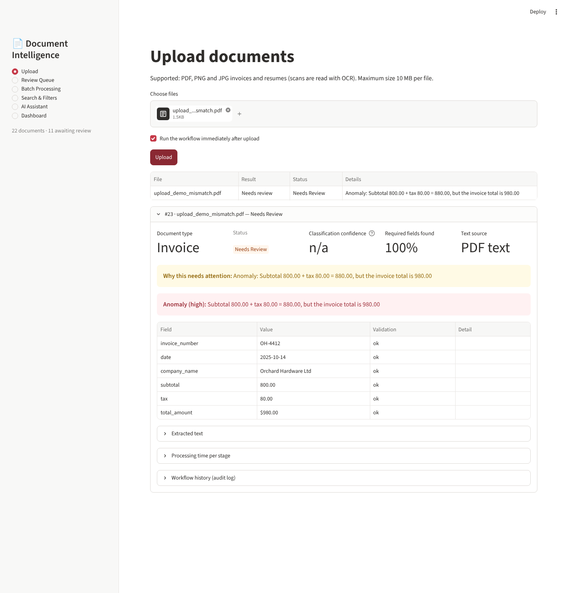
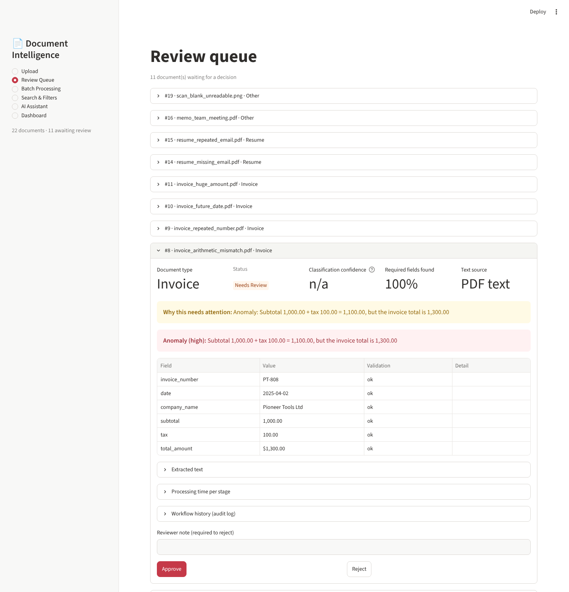
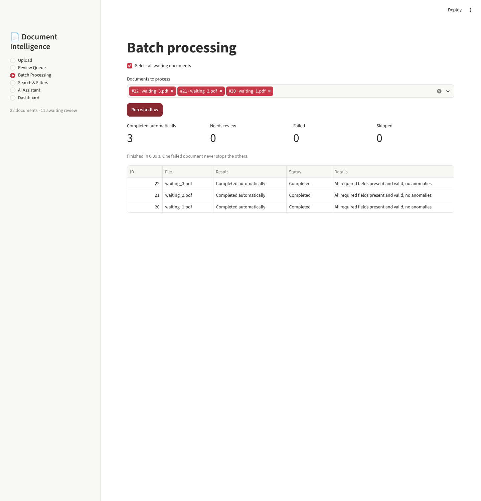
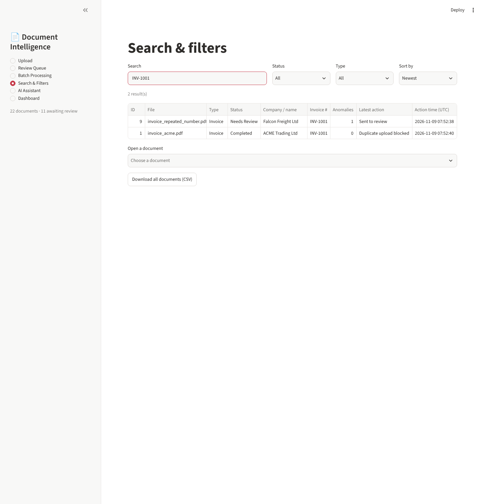
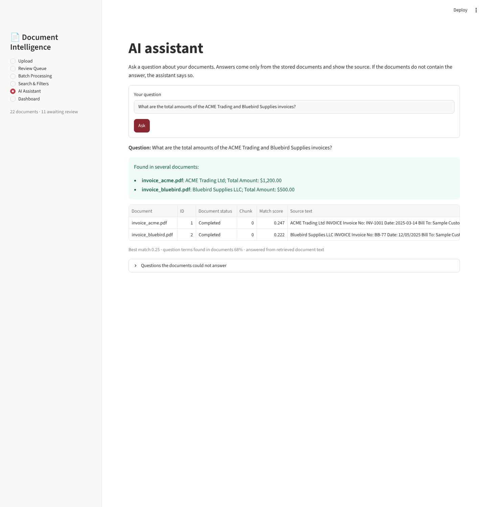
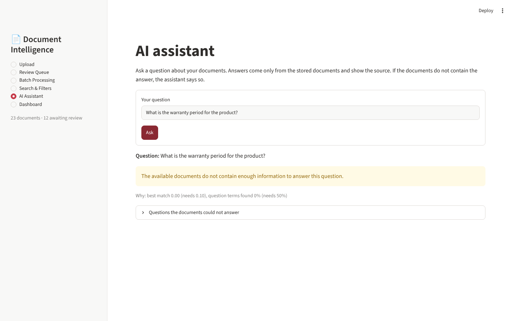
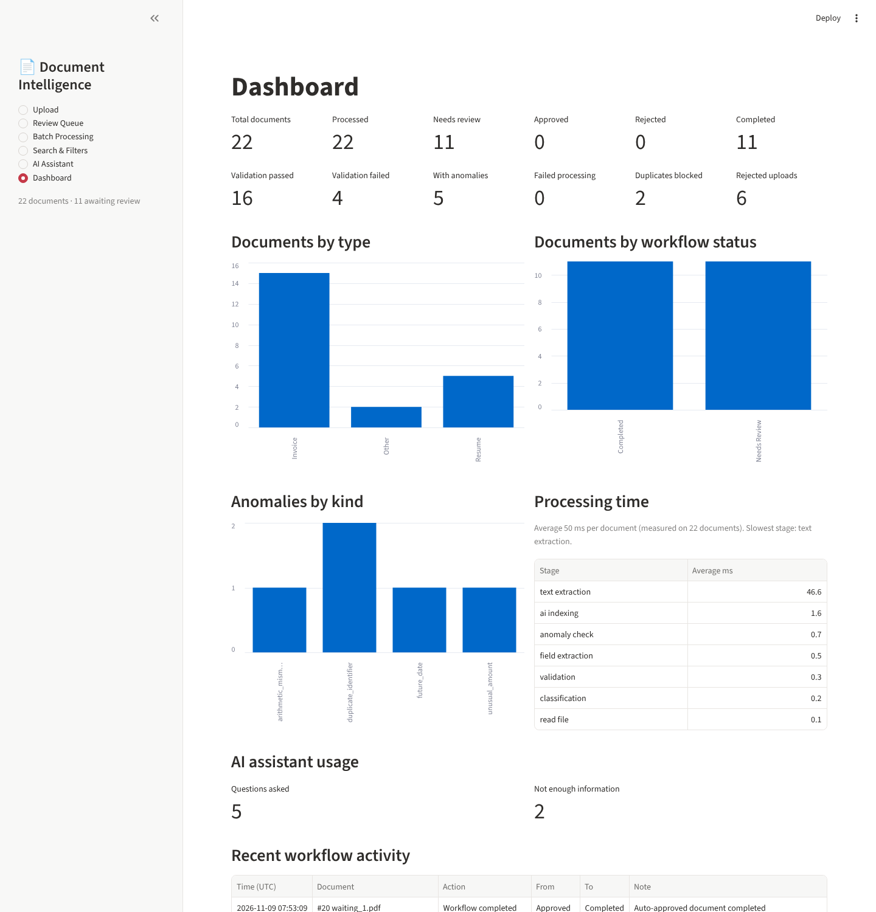

# AI Document Intelligence & Workflow Platform

A complete document-processing product. You upload invoices and resumes (PDF or scanned images). The platform reads them, works out what they are, pulls out the important details, checks the details, and decides what should happen next. Anything missing, wrong, uncertain or suspicious is sent to a person for review. Every step is saved in a history, and you can ask questions about your documents and get answers that point to the source.

This is the final project (Week 6). It combines the work of Weeks 1–5 into one system and adds security, anomaly detection, an AI assistant, a REST API and deployment files.



## What it does

| Area | What you get | Built in |
|---|---|---|
| Reading documents | PDF text, OCR for scans (Tesseract), cleaned text | Weeks 1, 3 |
| Understanding documents | Classify as Invoice / Resume / Other, extract fields, "Not Found" instead of guessing, optional trained model with a real confidence score | Weeks 1, 3 |
| Storing documents | Safe file storage in type folders, SQLite database, duplicate detection (SHA-256), search, filters | Week 4 |
| Workflow | Six states, blocked invalid moves, validation rules, rule engine, review queue, audit history, batch processing | Week 5 |
| Anomaly detection | Repeated invoice number / email, subtotal + tax ≠ total, future dates, unusually large amounts | Week 6 |
| AI assistant | Ask questions about your documents; answers quote the documents and show sources; says so when the documents do not contain the answer | Week 6 |
| Security | Real file-type checks, size and page limits, safe paths, API key, no secrets in code | Week 6 |
| Performance | Stored results reused, OCR cache, search index cache, time measured per stage | Week 6 |
| API and deployment | FastAPI REST API, Dockerfile, docker-compose, `.env.example` | Week 6 |

## The workflow

```
Upload → Validate file → Read text / OCR → Classify → Extract fields → Validate fields
      → Anomaly check → Index for the assistant → Decision
                              ├── all good  → Approved → Completed
                              └── anything wrong → Needs Review → (person) Approve → Completed
                                                                       └─ Reject (reason required) → Rejected
```

Document states: **New → Processing → Needs Review / Approved → Completed**, or **Rejected**. Any other move is blocked, nothing changes, and the attempt is written to the audit log.

A document goes to **Needs Review** if any of these is true:
1. No readable text was found (blank or poor scan).
2. The document type has no automated rules (for example a memo).
3. The classifier is unsure (only when a trained model gives a confidence below the threshold, default 0.60).
4. A required field is missing.
5. A field is invalid (bad email, impossible date, zero total, ...).
6. An anomaly was found.

## Screenshots

| Upload | Review queue (anomaly shown) |
|---|---|
|  |  |

| Batch processing | Search & filters |
|---|---|
|  |  |

| AI assistant answer | AI assistant: not enough information |
|---|---|
|  |  |



## Quick start

You need Python 3.10 or newer and the Tesseract OCR program (only for scanned images).

```bash
# 1. Install Tesseract (Ubuntu/Debian). Windows: install the UB Mannheim build. Mac: brew install tesseract
sudo apt install tesseract-ocr

# 2. Install the Python packages
python -m venv .venv && source .venv/bin/activate      # Windows: .venv\Scripts\activate
pip install -r requirements.txt

# 3. (optional) Settings
cp .env.example .env

# 4. Start the app
streamlit run app.py                                    # opens http://localhost:8501

# 5. (optional) Start the REST API in a second terminal
uvicorn api:app --port 8000                             # docs at http://localhost:8000/docs
```

To try it with ready-made data:

```bash
pip install -r requirements-dev.txt
python make_samples.py        # creates sample_docs/ (19 documents + 6 invalid files)
python seed_demo.py           # loads them into the app
```

## Using the app

* **Upload** – choose PDF / PNG / JPG files. Tick the box to process them straight away. Files that are not accepted are explained in plain words.
* **Review queue** – every document that needs a person. You see why, the extracted fields with their validation result, any anomaly, and the history. **Approve** completes it. **Reject** needs a reason.
* **Batch processing** – process many waiting documents at once. You get counts (completed, needs review, failed, skipped) and one result per document. One bad document never stops the rest.
* **Search & filters** – search by file name, company, invoice number, person name or email; filter by status and type; sort; open a document; download a CSV.
* **AI assistant** – ask a question such as *"What is the total amount on invoice HL-310?"* or *"Which documents mention Python?"*. See the answer, the source documents and the match score. Questions the documents cannot answer are listed so you can see the gaps.
* **Dashboard** – totals, status and type charts, validation results, anomalies, failures, duplicates, rejected uploads, average time per stage, recent activity and assistant usage.

## The AI assistant (how it works and what it cannot do)

It runs **locally** – your documents are never sent to an outside AI service.

1. Each processed document's text is split into small chunks and stored.
2. Chunks are turned into TF-IDF vectors (a word-based vector space; this is *not* a neural embedding model).
3. Your question is compared with all chunks by cosine similarity.
4. The answer is built **only** from lines of the best-matching chunks, and the document, chunk and score are shown.
5. If the best match is weak, or too few of the question's words appear in the documents, it answers *"The available documents do not contain enough information to answer this question."* Every question, answered or not, is logged.

Limits: it matches **words, not meaning**, so a question using words the documents never use may be refused. Rejected documents are not used. Answers from documents that are still in review show their status.

## REST API

Start it with `uvicorn api:app --port 8000`, then open `/docs` for the interactive page. Main endpoints:

| Method and path | What it does |
|---|---|
| `GET /health` | Is the service running |
| `POST /documents` | Upload a file (and process it) |
| `GET /documents`, `GET /documents/{id}` | List / search, and detail with history |
| `POST /documents/{id}/process` | Run the workflow |
| `POST /documents/{id}/approve`, `/reject` | Review decisions |
| `POST /ask` | Ask the assistant |
| `GET /metrics`, `GET /reports/documents.csv` | Numbers and report |

Set `API_KEY` in `.env` to require the header `X-API-Key`. Full details and examples are in [docs/API.md](docs/API.md).

## Settings

All settings are optional and can be set in `.env` or as environment variables (see `.env.example`).

| Setting | Default | Meaning |
|---|---|---|
| `APP_DATA_DIR` | `data` | Folder for the database and stored files |
| `MAX_FILE_MB` | 10 | Largest allowed upload |
| `MAX_PDF_PAGES` | 50 | Most pages in one PDF |
| `CONFIDENCE_THRESHOLD` | 0.60 | Below this a model's classification goes to review |
| `AMOUNT_TOLERANCE` | 0.01 | Allowed difference for subtotal + tax = total |
| `OUTLIER_FACTOR` / `OUTLIER_MIN_DOCS` | 10 / 4 | A total this many times the median of at least 4 other invoices is flagged |
| `RAG_MIN_SCORE` / `RAG_MIN_COVERAGE` | 0.10 / 0.50 | How strong a match the assistant needs before it answers |
| `MODEL_PATH` | `model.joblib` | Optional trained classifier (a scikit-learn pipeline with `predict_proba`) |
| `API_KEY` | empty | If set, the API requires it |

## Project files

| File | Purpose |
|---|---|
| `app.py` | Streamlit pages |
| `api.py` | FastAPI REST API |
| `service.py` | The pipeline: upload, process, batch, restart recovery |
| `workflow.py` | States, allowed moves, decision rules, approve / reject |
| `storage.py` | Upload checks, safe file names and paths, type folders |
| `processor.py` | File integrity checks, PDF text, OCR, OCR cache |
| `classifier.py` | Rules, or a trained model if present |
| `extractor.py` | Field extraction (regular expressions) |
| `validator.py` | Required fields and format checks |
| `anomaly.py` | Duplicate identifiers, arithmetic, dates, unusual amounts |
| `rag.py` | Chunking, search index, grounded answers |
| `database.py`, `audit.py` | SQLite storage and the audit log |
| `reports.py` | CSV report |
| `config.py` | Settings |
| `make_samples.py`, `seed_demo.py` | Sample documents with answers, demo data |
| `test_e2e.py`, `evaluate.py` | Tests and measured results |

More detail: [docs/ARCHITECTURE.md](docs/ARCHITECTURE.md) · [docs/API.md](docs/API.md) · [docs/DEPLOYMENT.md](docs/DEPLOYMENT.md)

## Testing and results

```bash
python make_samples.py
python test_e2e.py        # 149 checks -> TEST_RESULTS.md
python evaluate.py        # accuracy numbers -> EVALUATION.md
```

* **[TEST_RESULTS.md](TEST_RESULTS.md)** – 149 / 149 checks pass. It covers every required case: clean PDF, scanned/OCR, supported types, missing fields, duplicates and repeated identifiers, unsupported type, corrupt file, low confidence, arithmetic mismatch, invalid transition, mixed batch, restart, assistant answers and "not enough information", review actions, search; plus security, performance, the API and every Streamlit page. The same suite also passes in a fresh virtual environment.
* **[EVALUATION.md](EVALUATION.md)** – accuracy on the labelled sample set (classification 19/19, fields 76/76, anomalies 5/5, assistant 10/10 answered and 6/6 refused).

**Please read this honestly:** the sample documents are small, clean and made for this project, so 100% means "works as designed on known cases", not "100% accurate on real-world documents". Real invoices and CVs are messier; use real labelled files with `evaluate.py` to measure that.

## Security

* File type is checked by name **and by the real content** (a renamed program is refused); size, PDF page count and image size are limited; password-protected and corrupt files are refused before anything is stored.
* File names are cleaned; files are stored only under the storage folder, and reading refuses any path outside it (including `../` and symlinks).
* All database queries use parameters (a SQL-injection test is included). Raw errors are logged, never shown; users see plain messages.
* The API can require a key (`X-API-Key`); it never returns internal file paths. Secrets live in `.env` (ignored by git), never in code.
* The Streamlit app has **no login**. Run it on a trusted network or behind a reverse proxy / SSO if others can reach it.

## Performance

* A document already processed is **not** processed again; stored results are reused.
* Exact duplicate files are stopped at upload by their SHA-256 hash.
* OCR output is cached by file hash; the search index is built once and reused until documents change; the classifier model is loaded once.
* Time is recorded for each stage (read, text, classify, extract, validate, anomaly, index) and shown on the dashboard. On the sample set OCR dominates (about 1.6 s per scan versus about 16 ms for a digital PDF). A batch of 40 documents ran in a few seconds.

## Known limits and ideas for later

* Extraction is regex-based and tuned to English labelled invoices/resumes. A trained model (for example from Week 3) can replace the classifier through `MODEL_PATH`.
* A repeated invoice number is flagged on the *later* document; the earlier one is not changed.
* The assistant is word-based. Adding neural embeddings or an LLM would help with paraphrased questions, but should only be used with documents you are allowed to send to that service.
* One SQLite file is fine for a team-sized workload; use PostgreSQL for heavy multi-user use.
* The Docker files and `docker-compose.yml` were written but could not be run in the build environment (no Docker there); the app, API, tests and a clean virtual-environment install were all run.
